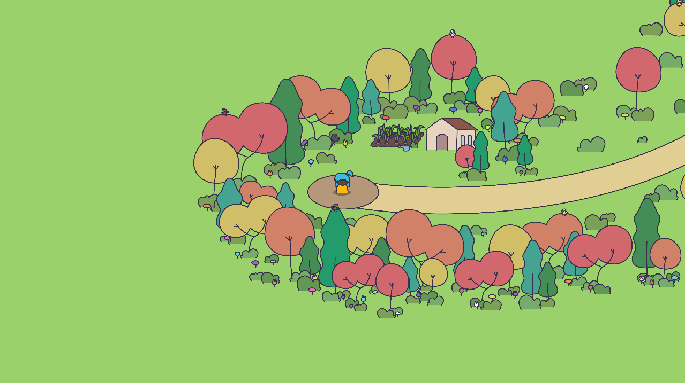
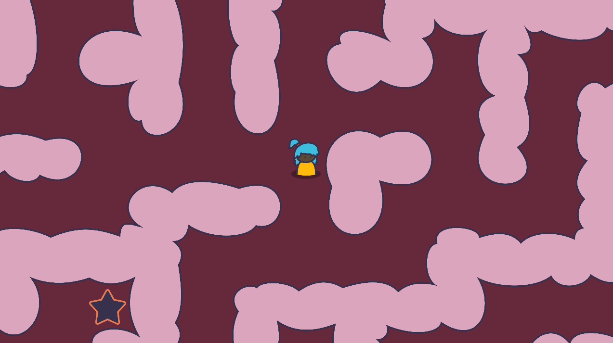
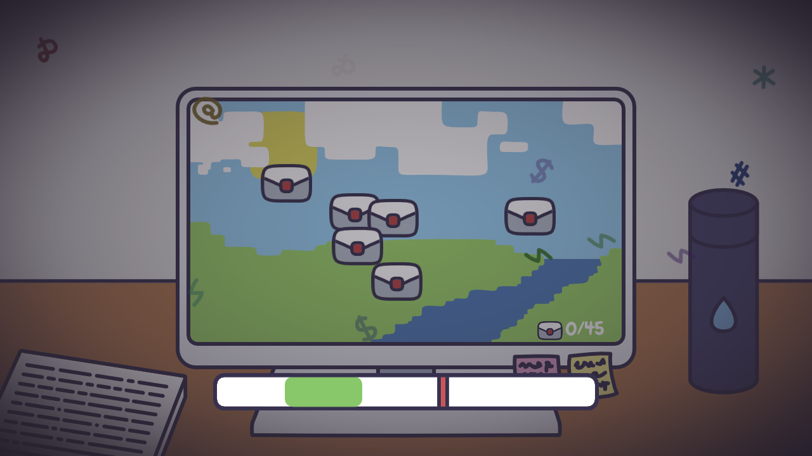
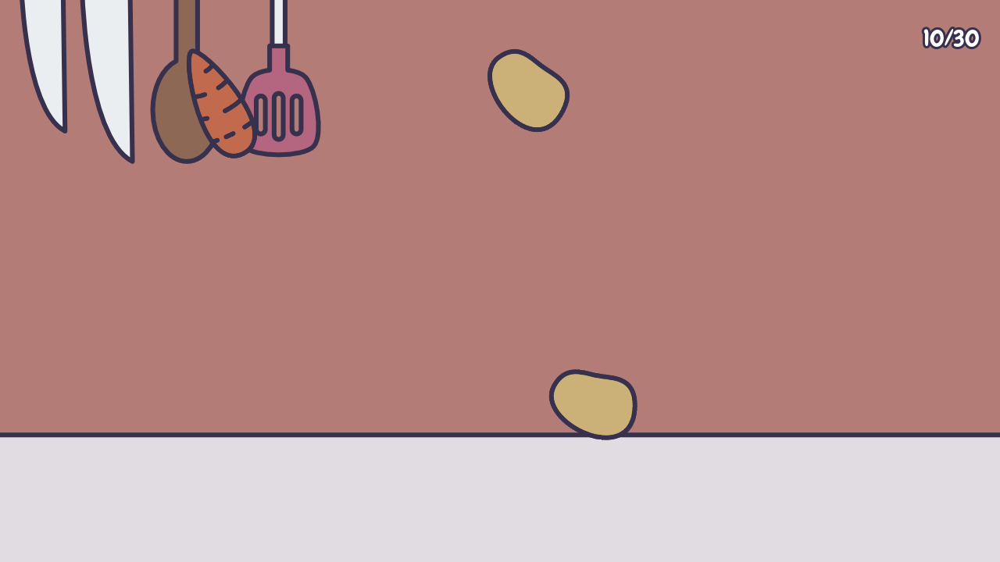
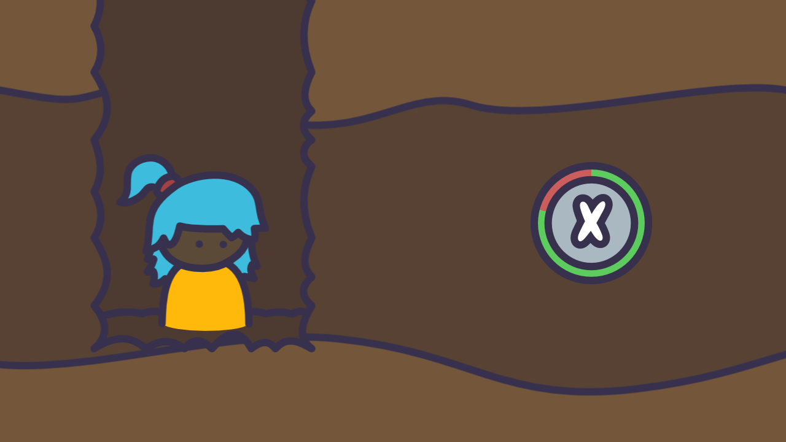
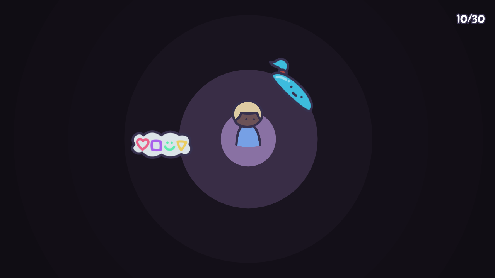
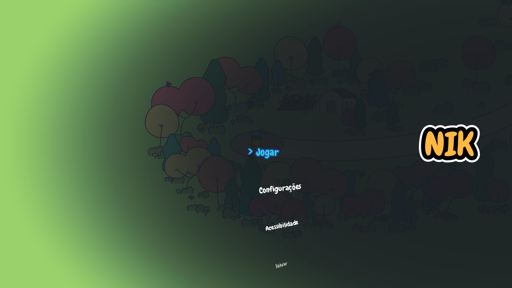
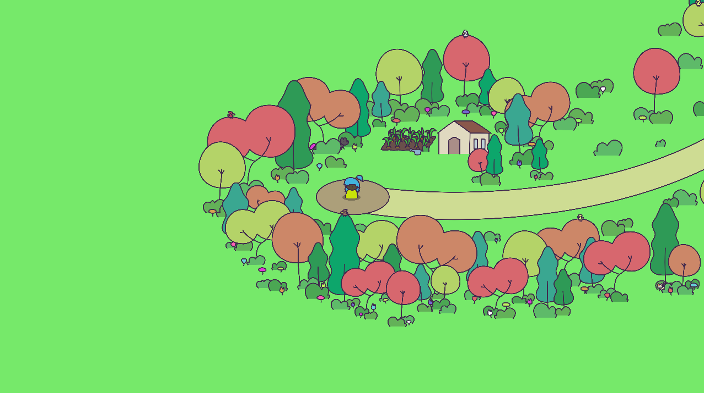
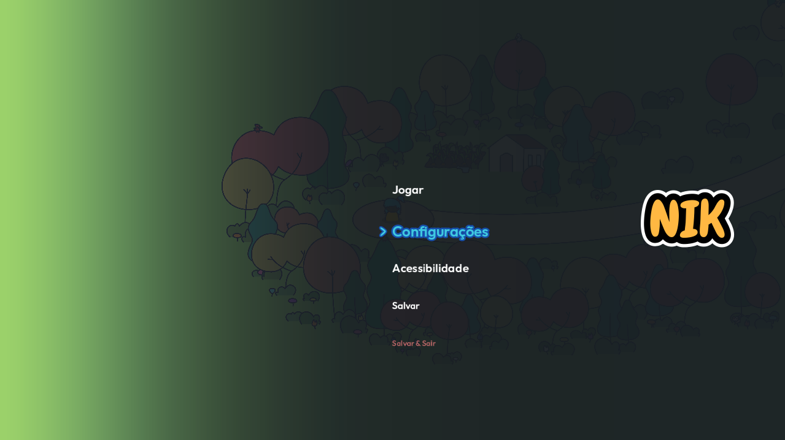
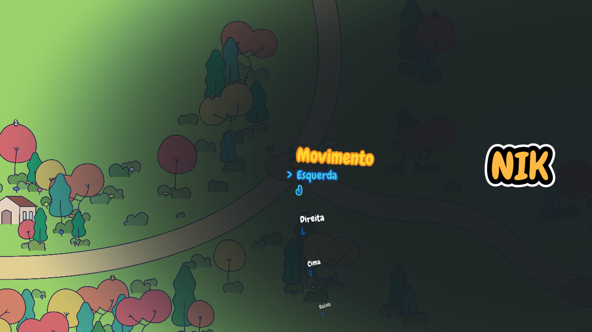

# Nik Is Kind
𝓶𝓮 𝓵𝓮𝓲𝓪

A tristeza tomou conta da vila, deixando todos os cidadãos desanimados e vulneráveis.
Cabe a você ajudar os moradores a recuperarem a alegria por meio de diversos _minigames_!

Os _minigames_ do jogo são únicos! Seguem alguns exemplos de joguinhos que serão feitos pela protagonista:

<table>
    <tr>
        <td></td>
        <td></td>
    </tr>
    </table>
        
    <table>
    <tr>
        <td></td>
        <td></td>
    </tr>
</table>

## Características Gerais
Plataforma: PC

Entrada: Mouse e Teclado

Requisitos: Batata Cozida ou Purê de Batata em formato de dispositivo eletrônico

## Menu e Acessibilidade

No menu inicial, estão disponíveis:
- Continuar Jogo *(quando existe um jogo salvo)*
- Novo Jogo
- Opções
- Sair

Em **Opções**, é possível acessar:
- **Configurações**
    - Volume master
    - Volume dos efeitos sonoros
    - Volume da música
    - Edição dos controles
- **Acessibilidade**
    - Filtros de daltonismo e intensidade

    - Menu circular
    - Idioma (português, inglês ou espanhol)
    - Fonte de fácil leitura

    - Eventos rápidos nos minijogos
    - Guia de caminhos
    - Elementos piscantes

As alterações podem ser salvas dentro das telas de configurações e controles. No jogo, os controles padrão são **WASD** ou **Setinhas** para movimentação e **E** ou **ESPAÇO** para interagir.

## Créditos
Desenvolvido por:
- [André Dias de Paula](https://github.com/Andreerdd): Programação, Design e Produção Sonora
- [Frederico Santos Gonçalves](https://github.com/TalkedSphere): Programação e Design
- [Gabriel Della Gaspera](https://github.com/dellagaspera): Programação, Design e Produção Sonora

Agradecimento Especial:
- Xande;
- Flávia Thaís;
- Beatriz Maria Monteiro;
- Duda Moreira;
- Profª Virgínia;
- Allana Mátar;
- Gabriel Nascimento dos Santos;
- Codama;
- Hiago;
- Izabella Torres;
- Você =D

Acesse os slides sobre o Menu _(Parte 1)_ [aqui](https://canva.link/0i8k9a8wbgczz79).
